# WTFTD — War Thunder Full Test Drive

> **Beta** — it works, but some features are still untested in game (see *Known limits*). Feedback and bug
> reports are welcome in the issues.
>
> **Disclaimer** — I'm not a professional developer: WTFTD is a hobby project, built with the help of AI
> tools. The code is open and tested, but expect rough edges, and check it yourself if in doubt.

[](https://github.com/StonewarP/WTFTD-War_Thunder_Full_Test_Drive/releases)
[](https://github.com/StonewarP/WTFTD-War_Thunder_Full_Test_Drive/actions/workflows/tests.yml)
[](LICENSE)
[](https://ko-fi.com/stonewarp)

Test drive **any** War Thunder vehicle — ground, aircraft, helicopters, boats, ships — with the
loadout, ammunition, map, targets and conditions you choose, even vehicles you don't own. Hang any weapon
of the game on any pylon, or **make your own weapons**: more explosive, more thrust, 100 G missiles, nuclear
Sidewinders…

WTFTD takes an **official Test Drive / Test Flight mission** from the game files (with its targets,
triggers and respawn logic), puts your vehicle and setup in it, and writes it to
`War Thunder/UserMissions/`. In game: **Single missions → User missions**.

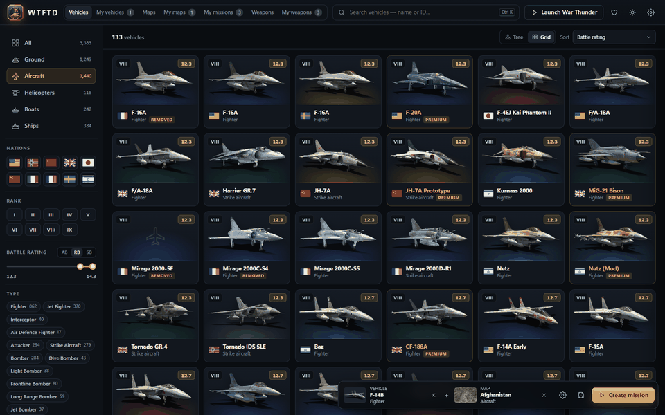

## Download

**[⬇ Download WTFTD-&lt;version&gt;.exe](https://github.com/StonewarP/WTFTD-War_Thunder_Full_Test_Drive/releases)** (Windows 10/11) or
**WTFTD-&lt;version&gt;.zip** (macOS, Apple silicon) — nothing to install: double-click it, the app opens in its own
window and finds your game by itself (Steam or standalone). Close the window to quit.

- **First launch**: a welcome screen says where WTFTD keeps its files and what it downloads from where, and
  asks where the game data should come from. Nothing starts before you accept.
  - *Read my installed game*: no download. WTFTD unpacks the game's own files on your PC (≈650 MB on disk, about
    3 minutes), always at your game's exact version, offline.
  - *Download the community datamine*: ≈1 GB from the community
    [War Thunder datamine](https://github.com/gszabi99/War-Thunder-Datamine) (2–5 minutes). It works without the
    game, but it's community data and can be ahead of or behind your game. If Git isn't installed, the official
    portable MinGit (git-for-windows) is fetched automatically.

  Either way WTFTD builds its database on your PC (no game data is shipped with it), and updates it after each game
  patch. Change the source at any time in **Settings → Game data**.
- Your settings, missions and the game database live in `%LOCALAPPDATA%\WTFTD` (Windows) or
  `~/Library/Application Support/WTFTD` (macOS).
- The apps are not code-signed: if Windows SmartScreen warns you, click **More info → Run anyway**. On macOS,
  unzip `WTFTD-<version>.zip`, move `WTFTD.app` to *Applications*, open it once, then allow it in **System Settings →
  Privacy & Security → Open Anyway**. Both are built by GitHub Actions from the released source code, and each
  release lists their **SHA-256**: check your download with `Get-FileHash WTFTD-<version>.exe` in PowerShell or
  `shasum -a 256 WTFTD-<version>.zip` in Terminal.
- The app window uses Edge or Chrome (on macOS: Chrome, Edge, Brave or Chromium) in app mode; without one,
  WTFTD opens in your default browser.
- When a new version is released, the app tells you (a *New version* button at the top) — download the new version
  and replace the old one; your settings and missions are kept.

## How it works

1. **Pick a vehicle** (*Vehicles*: list or research trees, filters by category, type — light / heavy tank,
   fighter, bomber… —, nation, rank, BR, stats, carried weapons).
2. **Pick a map** (*Maps*: every official test drive / test flight scenario, with the game's tactical map).
3. **Set it up** in the vehicle panel: loadout (pylon by pylon), ammunition, modifications, cheats, fuel —
   and the map in the scenario editor (targets, allies, your start).
4. **Create mission**, start War Thunder (button in the app), open *Single missions → User missions*.

In the scenario editor, a switch turns the flat map into **the real level in 3D**, read from your own game: place units
and the game's assets on its relief and turn them the way you want. Vehicles and weapons have a **3D view** too.

While you fly (Windows), the **In flight** menu puts your own overlay over the game, beeps before your aircraft
breaks, and records the flight: live curves, a flight report, a cockpit window for a second screen, the battle log.

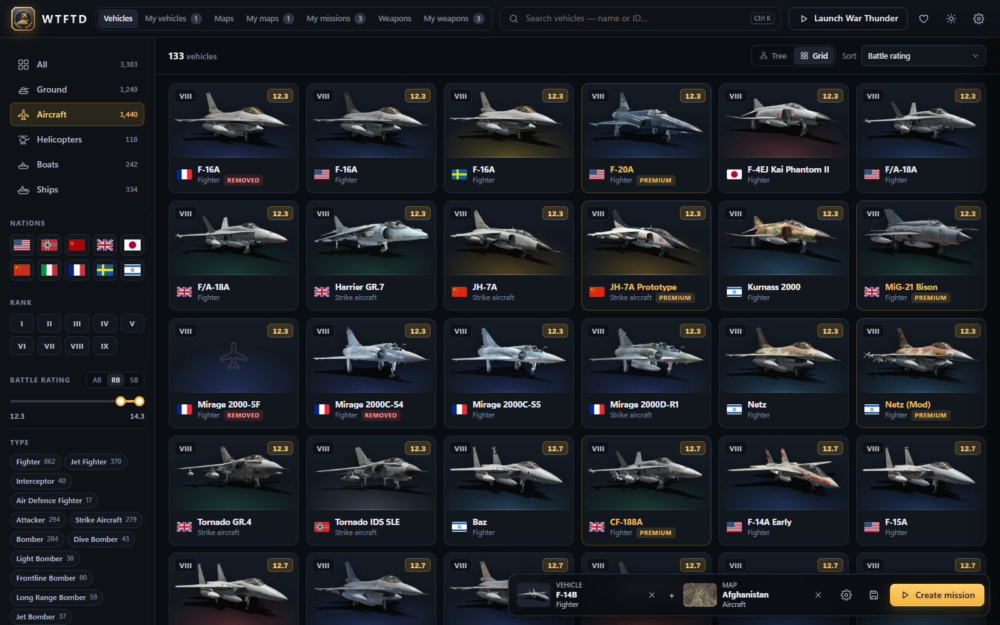

| Research trees | Stats: tanks over 60 km/h, best turret armor first |
|---|---|
| 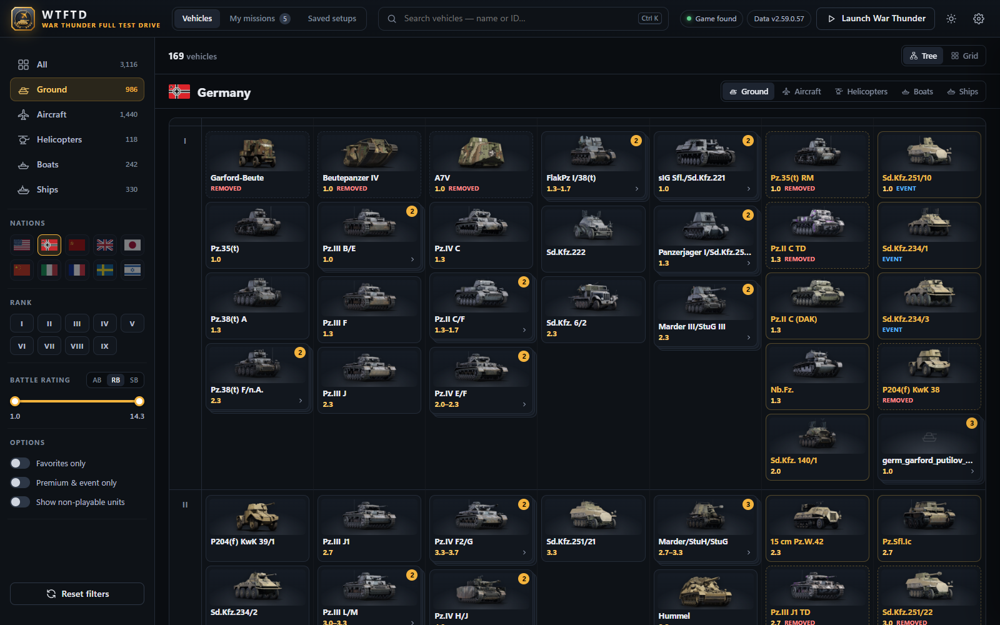 | 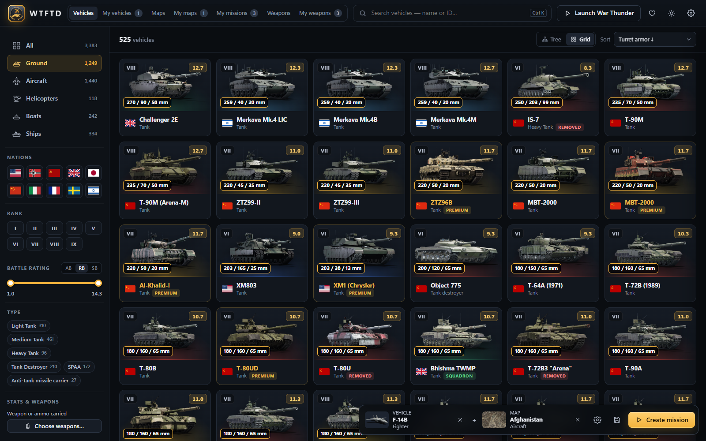 |

| Carrying the AIM-9L, fastest first, vehicle stats | Weapon picker: vehicles carrying given weapons |
|---|---|
| 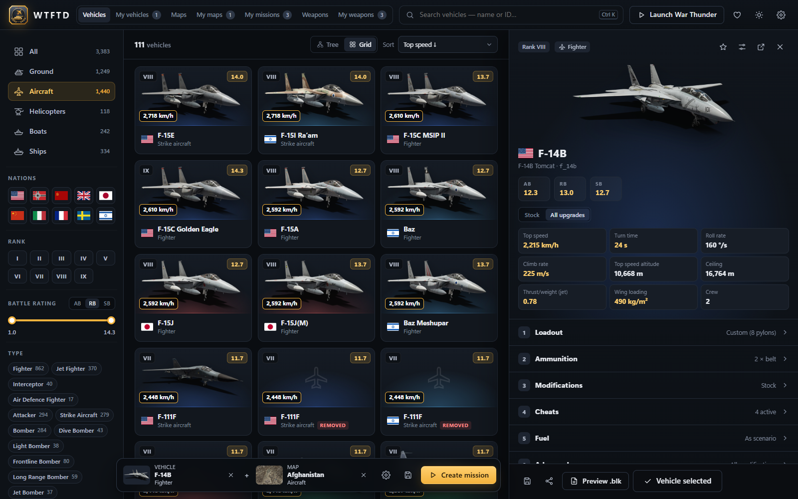 | 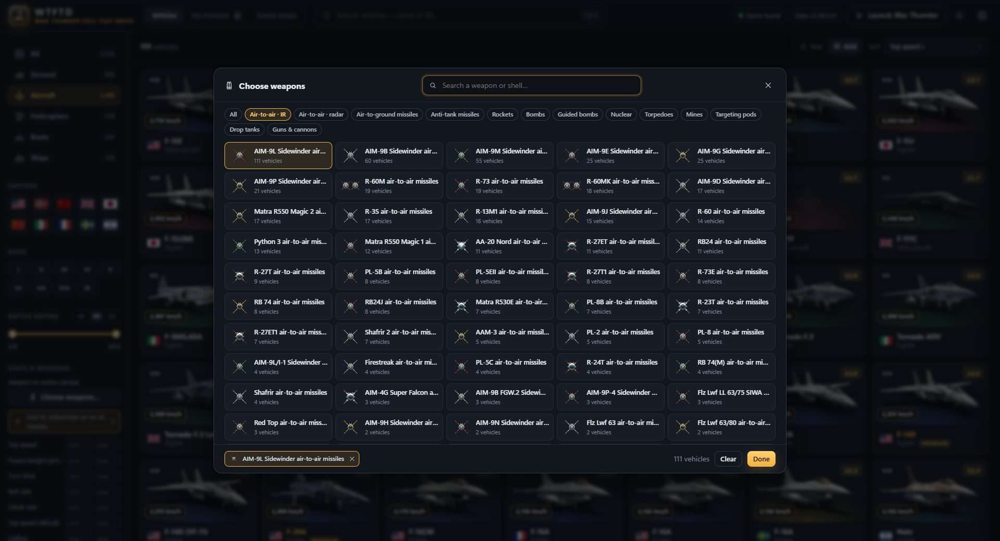 |

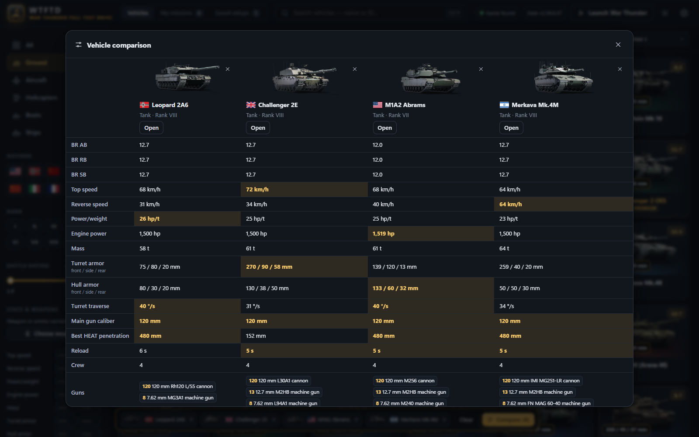

| Pylon editor: your own weapons next to the game's | Cheats: invulnerable, unbreakable airframe, super mobility, no reload |
|---|---|
| 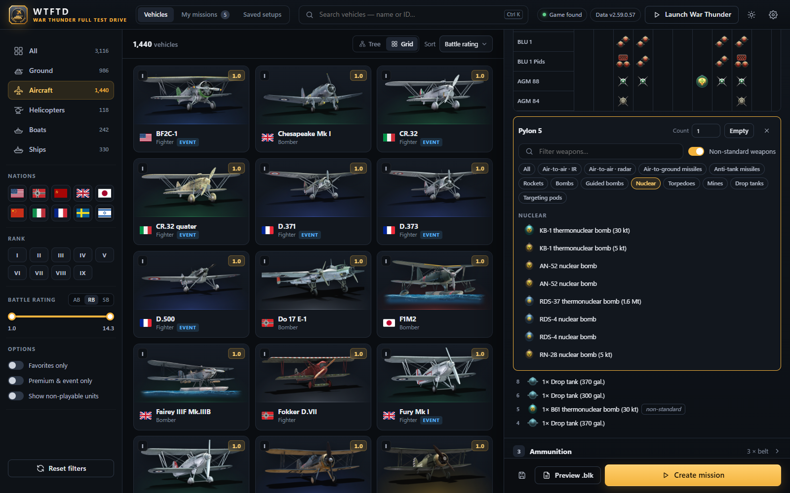 | 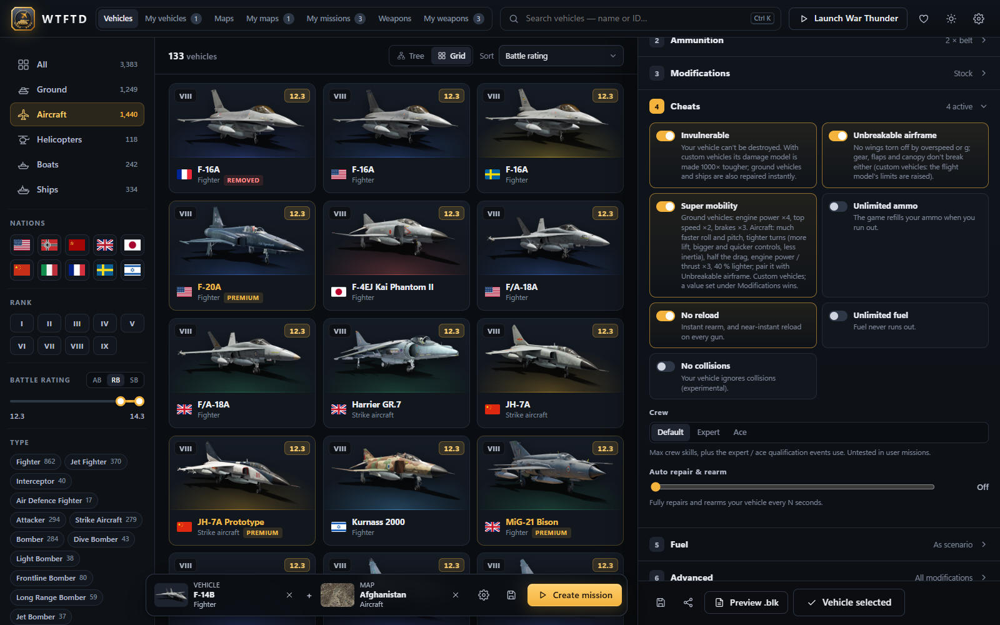 |

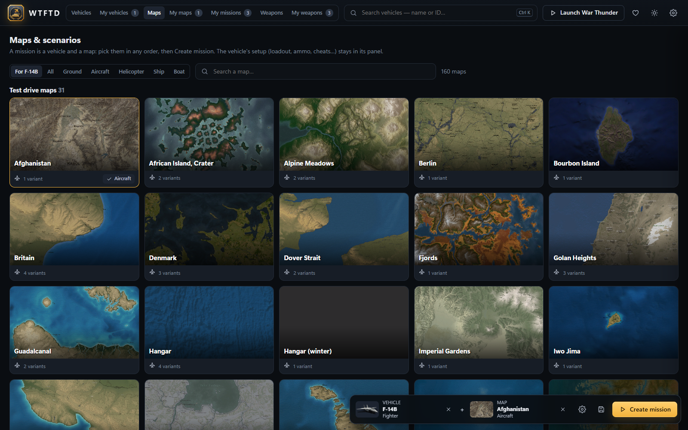

| Scenario editor on the real map, with ground heights | Test flight: your start and the scenario's targets |
|---|---|
| 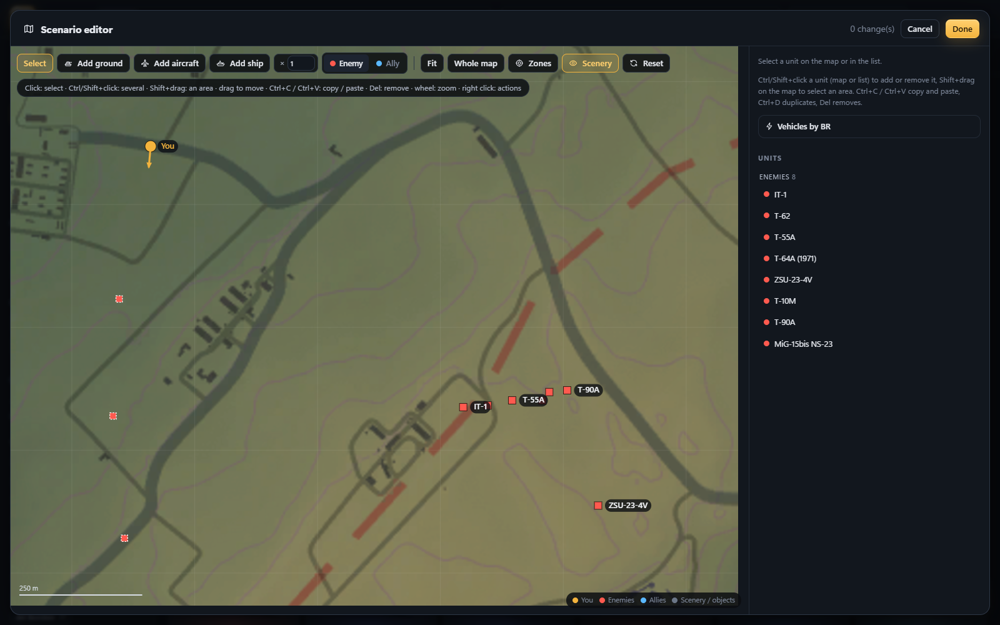 | 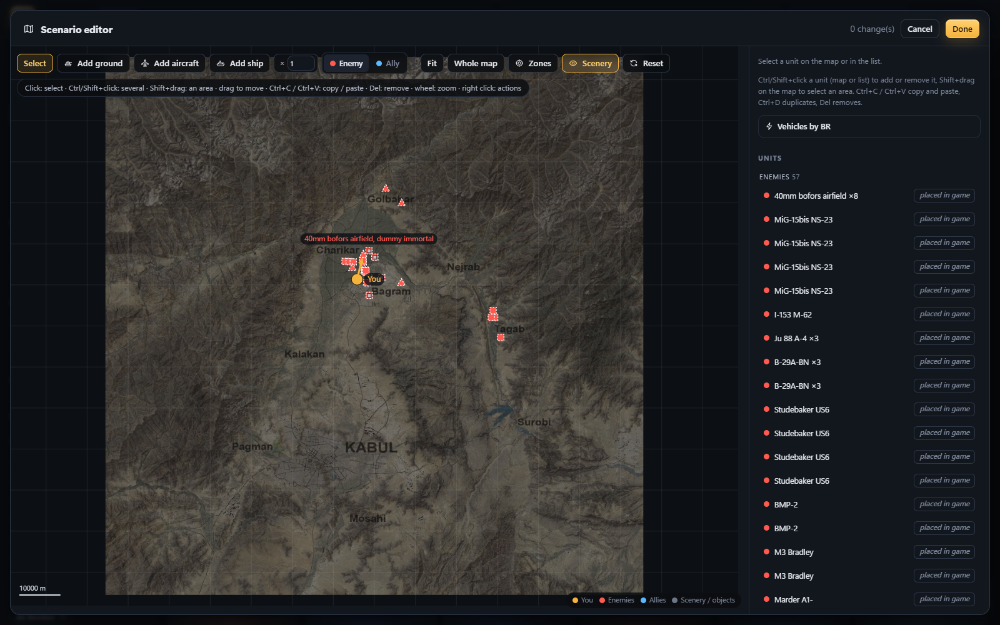 |

| Weapons page: IR missiles ranked for dogfight, R-73 details and community view | Comparing weapons side by side |
|---|---|
| 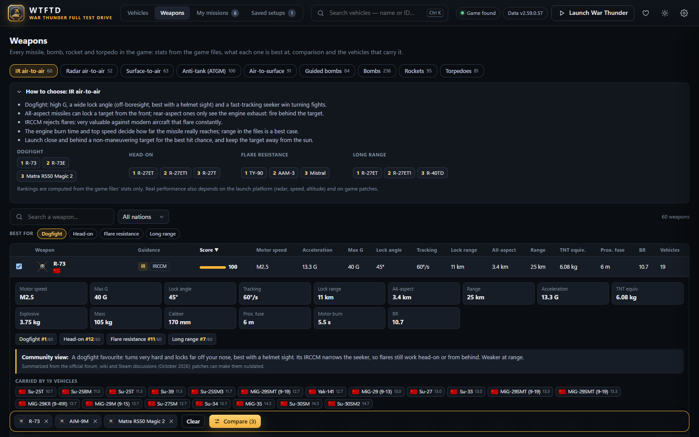 | 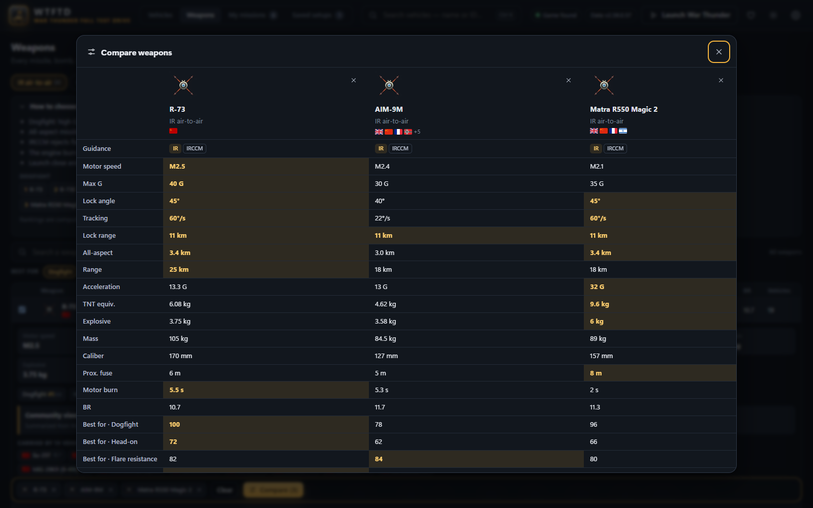 |

| My weapons: an AIM-9L at 100 G and thrust ×5, a nuclear AIM-9M, a 10-tonne Mk 82 | The weapon editor: Simple… |
|---|---|
| 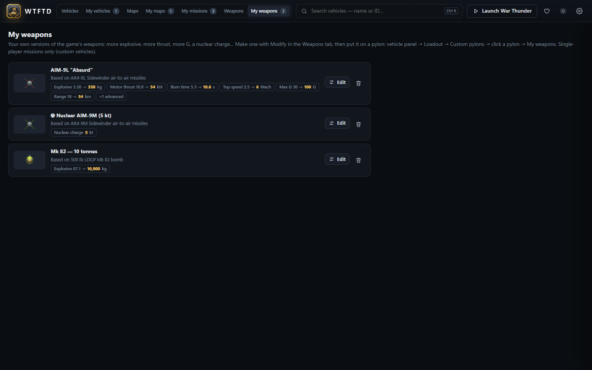 | 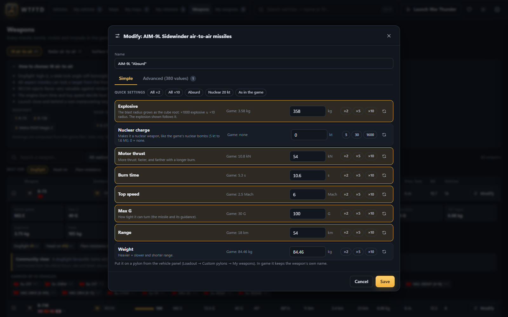 |

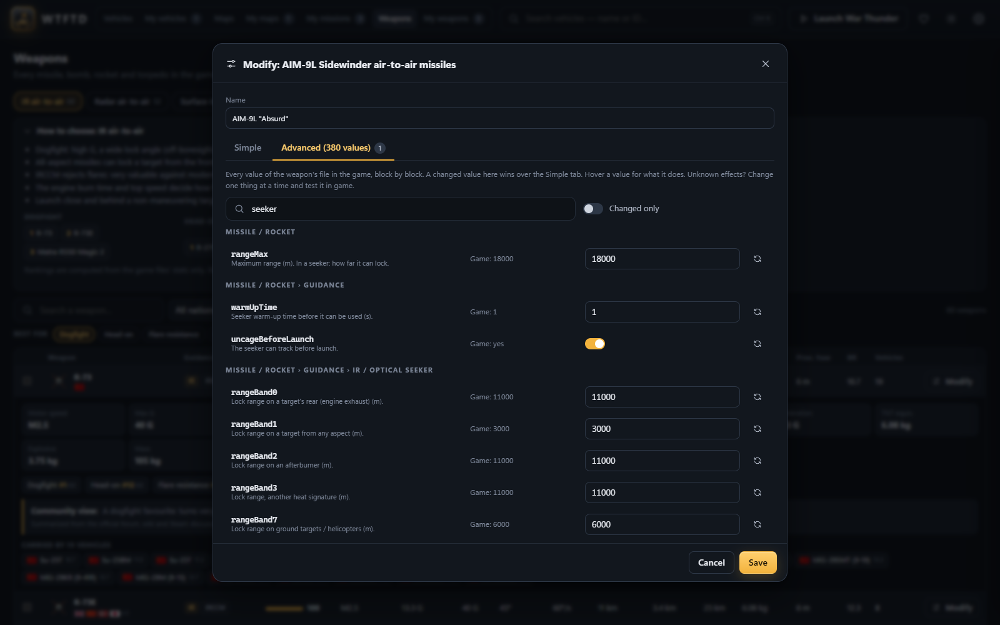

## Features

- **3,700+ vehicles** with images from the [War Thunder wiki](https://wiki.warthunder.com/), grid or
  research-tree view, filters (category, **vehicle type** — light / medium / heavy tank, tank destroyer, SPAA,
  fighter, bomber, attacker, helicopter, drone, destroyer… with the game's own names —, nation, rank, BR in AB/RB/SB,
  favorites, premium/event, non-playable units), **sort by rarity** with badges (premium, squadron, pack, event,
  removed, hidden)
- **Stats & fine search**: each vehicle's performance — top / reverse speed, power-to-weight, engine power,
  turret / hull armor, turret traverse, gun caliber, AP and HEAT penetration, reload; for aircraft turn time, roll rate,
  climb rate, ceiling, thrust-to-weight, wing loading; for ships displacement — shown on its card, with a
  **Stock / All upgrades** switch (stock values from the modules' penalties, estimated for aircraft), **sortable**
  (fastest, best turning, best armored…) and **filterable with min / max** values. **Weapon picker**: pick carried
  weapons by their game icon (missiles, bombs, rockets, nuclear, guns, shells — or a shell type like “any
  APFSDS”), with how many vehicles carry each; vehicles must carry all the picked weapons
- **Weapons page**: every missile, bomb, rocket and torpedo (~870) by category — IR / radar air-to-air,
  surface-to-air, ATGM, air-to-surface, guided bombs, bombs, **nuclear bombs** (yield from 5 kt to 1.6 Mt, and the
  ground battles' instant-win killstreak nukes), rockets, torpedoes — with stats from the game files
  (motor speed, max G, lock angle, IRCCM, seeker range, penetration, TNT equivalent…), **"best for" rankings**
  (dogfight, head-on, flare resistance, beyond visual range, killing tanks, stand-off…), a short guide per
  category, community notes on well-known weapons, side-by-side comparison and the vehicles that carry each one. The
  search also finds a weapon by what carries it: `S-300` finds the 5V55R.
  **Bombing a target**: pick a base or an airfield, and see its HP from the game's mission templates, what one weapon
  takes off it and how many it takes
- **3D view** (prototype): a vehicle's or a weapon's model with its textures and paint, with a weapon's positions (stowed,
  deployed, in its container) and its parts (booster, fins, caps), which can be left out one by one. Read from your own game
  files: nothing is stored or exported, and no model or texture is in this project. The paint is an approximation
- **Compare up to 5 vehicles side by side** (button next to the favorite star): BR, every stat with the best
  value highlighted, guns with their caliber, shell types, pylon weapons
- **Penetration by distance** (vehicle panel → Ammunition): a curve for every shell and guided missile of the gun,
  with the values at 10, 100, 500, 1000 and 2000 m
- **Research and purchase cost**: each vehicle's RP and SL to sort, filter and compare, and a *Research path* that
  adds them up along the line, from the first vehicle to the one you picked
- **Breaking limits** in the vehicle panel of aircraft and helicopters: speed, Mach, gear, flaps, variable sweep
- **Maps tab**: 100+ official scenarios with the game's own tactical map — firing range, Fulda, naval
  range, airfields, heli ranges, carriers, seaplane bases… plus the **hangar maps** (regular, winter,
  Halloween, Lunar New Year, anniversary); the ones that fit your vehicle first
- **Loadout**: every official preset, or a **pylon editor** laid out like the game's (presets as rows,
  pylons as columns, game icons). Turn on **non-standard weapons** to mount any of the game's ~2,300 air
  weapons on any pylon — missiles, bombs, rockets, torpedoes, pods, and **nuclear bombs** (RN-28, RN-40,
  B61, AN-52, KB-1, RDS-4, RDS-37) — and the **missiles, rockets and guns of ground vehicles and ships** (S-300, Pantsir,
  Aster, Smerch...: the Aster-30 is checked in game, the others not yet), with a warning when the aircraft lacks the radar / laser designator /
  guidance the weapon needs. Pylons fire one at a time, as in the game
- **My weapons**: your own versions of the game's missiles, bombs, rockets and torpedoes (see below), on
  your pylons and on AI aircraft
- **Ammunition**: 4 shell slots with round counts for tanks; belts per gun for aircraft, helicopters and ships; the
  game's own shell and belt icons; **flares / chaff split** for countermeasure launchers (beta, see *Known limits*)
- **Modifications** (custom vehicles): engine power, mass, top speed, brakes, turret speed, thrust,
  reload, ammo capacity, shell velocity / mass / explosive / penetration… On aircraft: another radar or warning receiver,
  another aircraft's engine, avionics on or off. On tanks and ships: another weapon in place of a gun. For all: the crew's
  language and voices. Not checked in game yet
- **Scenario editor** on the level's real tactical map, read from the game files, or **in 3D**:
  - drag any unit (and your start) to move it — ground units are put **on the ground** using the map's heightmap;
  - **turn what you place**: drag a selected unit's arrow, or use its heading slider. Several selected turn together, and the
    scenario's own vehicles keep the heading you give them;
  - move the map with the mouse, or **Z Q S D** on a French keyboard, **W A S D** on an English one;
  - add ground, air or naval units as **allies or enemies**, non-playable ones too (S-300 launcher and radars, carriers,
    trains...), **objects** (AA guns, trucks, buildings, radars, infantry), remove units, swap their vehicle;
  - **assets**: the game's own set pieces, about 500 of them, from a crate to a whole camp or an airfield, as its own missions
    place them. Not checked in game yet;
  - the units of the game's templates (test flight targets) can change vehicle too;
  - **vehicles by BR**: enemies, allies or a selection get vehicles of their own kind at your vehicle's BR (they
    follow it when you take another one) or at a BR you pick, from the nations you choose;
  - behaviour: still, aggressive, return fire or passive; enemies can **hunt you**, allies can **escort you**;
  - **routes** drawn on the map, shared by the units selected for a convoy, and **waves of enemies**, each one coming when
    the one before is destroyed. Not checked in game yet;
  - shows where the scenario really spawns you (runway / start area), the units it teleports and its zones at their real size;
  - **the real map in 3D** (prototype), one switch away, read from your own game files: the relief of the whole level, air
    maps included, the ground in its real colours, water, buildings, trees with their leaves, your units as their real models
    and the zones as volumes. Add, select, move and turn units as on the flat map; right drag turns the view, the wheel zooms
- **Ground battle maps**: the game's Domination layouts (79 on 55 maps) from either side's spawn, with the capture
  zones and the other side's spawn in the editor (a solo sandbox: no AI, score or capture)
- **Conditions**: time of day, weather, air start with altitude / speed (a speed that suits the aircraft by
  default), **fuel load** (% of the tanks)
- **Cheats**: invulnerable, unbreakable airframe (no wings torn off by overspeed or G), super mobility
  (engine power ×3–4, tighter turns), unlimited ammo, no reload, unlimited fuel, auto repair / rearm,
  passive targets, no collisions, expert / ace crew, **targets come back**; **in-mission keys**: switch
  invulnerability, instant reload and passive targets, repair, bring the targets back or go back to the start
  while you play (the game's Quick radio messages)
- **Custom sights** for ground vehicles: a sight of your UserSights folder or a `.blk` file you add
- **My overlay** (Windows, off until you turn it on; per aircraft or type if you like, for jets, propeller aircraft, tanks
  and ships): your own lines over the game
  in a click-through window (speed against the limit, altitude, fuel, any value the game sends), limits as speeds,
  percentages or both, placed on a picture of your screen with the game's HUD or your own screenshot; and beeps near
  your aircraft's breaking speeds with your thresholds and sounds or your own (mp3, wav...), on the sound output you
  choose, with a glow around the screen if you like, of the size you want and flashing or not; they stop when you crash.
  Any line can have its own alert on any value (`fuel < 15 %`, `G > 9`) and show under conditions of its own, in up to
  four text blocks with columns, a frame and a background, with an outline and its own colours for names, values and
  units. A key mutes the alarms, another hides the overlay. A line can also show **your stats**: kills per death, win rate and
  battles from *My battles*, and your kills and deaths in the battle under way. It reads the game's local data about your own
  vehicle and your own line of the battle log only, nothing is added to the game
- **Flight data** (Windows): live curves of what the game reports, in flight and in tanks and ships (speed, altitude, G, turn time, fuel use...),
  and a recorder: CSV logs for Excel, replayed in the app, with a **flight report** (top speed, best climb, best
  sustained turn, time to climb, fuel used) and an **export for Tacview**; saved views, and the curves as a picture
- **Cockpit window** (Windows): your aircraft's instruments as dials, in a window of their own for a second screen
- **Battle**: the game's chat and battle log, live, in their own tab, with a filter, and saved to a text file if you like
- **My battles**: your own history from the replays the game saves: date, map, game mode, vehicle, result, kills, deaths,
  assists, score, damage; totals and a summary by vehicle; filters by game mode, vehicle, map, dates and result. A vehicle
  opens its panel, a map opens that map. Only your own line is read: other players' names and numbers are neither kept nor
  shown. A replay doesn't hold the result of a battle you left before the end, and the game keeps its last 100 autosaved
  replays (rename one in the game to keep it)
- **Feedback** button: write a few words and GitHub's bug or idea form opens filled in; you read it and send it with
  your own account
- **11 languages**: English, Français, Deutsch, Русский, Polski, Español, Português, Italiano, Čeština,
  简体中文, 日本語 — picked from your Windows language on first launch (or on the welcome screen), vehicle,
  weapon and map names follow the game's own translations. UI translations
  other than English were machine-assisted and may contain mistakes: corrections are welcome. Some of the newest texts
  are still in English in the languages other than French
- **Uninstall** from Settings: everything, or only some parts (custom vehicle files in the game, missions,
  cache, game database, your settings and library, the app itself); War Thunder itself is never touched
- **Your library**: *My vehicles* (saved setups), *My maps* (scenario variants from the editor) and *My weapons*, each
  under its menu, and *My missions* (saved vehicle + map pairs and the missions created)
- **Share** a vehicle setup, a map or a mission with a friend: a short code to paste, or a `.wtftd` file — they
  import it (or drop the file on the window) and get the same thing: vehicle, loadout, ammo, map, editor
  changes, cheats. User missions are single-player, so each of you plays it on your own PC
- Dark / light theme, `.blk` preview, launch War Thunder; on Windows the app can start minimized, go to the notification
  area and close with the game

## Custom vehicles (on by default)

War Thunder only opens a user mission if you own its vehicle. With **custom vehicles** (Settings),
WTFTD uses the game's `userVehicles` mechanism (from the CDK, popularised by Ask3lad):

- the mission uses `unit_class:t="userVehicles/<host>"`, where `<host>` is a vehicle you own (US reserve
  vehicles by default: M2A4, PT-6, USS Litchfield — helicopters have no reserve, pick one you own).
  Aircraft get their own new file in `content/pkg_user` and need no host;
- WTFTD writes files that `include` the real vehicle and apply your **modifications**,
  **pylon-by-pylon loadouts** and **your own weapons** with `@override:` lines.

Rules: only new files are written (never a path that replaces a game file), every file is listed in
`user/cdk_manifest.json`, and **Settings → Remove custom vehicle files** deletes them (do it before
playing online if you want a clean install). One custom vehicle per type at a time: the last mission you
create defines it. This is not endorsed by Gaijin — use at your own risk.

## My weapons (custom weapons)

In the **Weapons** tab, **Modify** on a missile, bomb, rocket or torpedo makes your own version of it, kept in
**My weapons**; put it on a pylon from the vehicle panel (*Loadout → Custom pylons → a pylon → My weapons*).

- **Simple**: explosive, a **nuclear charge** (kilotons, like the game's nuclear bombs — it works on missiles
  too), motor thrust, burn time, top speed, max G, range, weight, each next to the game's value, with quick
  settings (×2, ×10, *Absurd*, *Nuclear 20 kt*). The explosion shown follows the new charge.
- **Advanced**: every value of the weapon's file — guidance, seeker, autopilot, fuse, damage, penetration… —
  block by block, searchable, each explained on hover.
- A weapon you edit later flies as it is now on every pylon that holds it; in game it keeps its own name.

How: WTFTD writes a new file per weapon (`content/pkg_user/gameData/Weapons/wtftd/…`) that `include`s the
game's own and overrides your values — never the game's file, so only your custom vehicles use it. Checked in
game (F-14B): 100 G turns, thrust ×5, 10 t of explosive, nuclear AIM-9M and Mk 84. The blast radius of
ordinary explosive grows as the cube root of the charge (×115 explosive ≈ ×5 radius): for a wide area, use a
nuclear charge.

## Map backgrounds & ground heights

The editor draws the level's tactical maps (full map + detailed ground-battle map) straight from the
game's texture packs (`content/base/res/*.dxp.bin`). They are Oodle-compressed: WTFTD uses the official
Oodle runtime (`oo2core_<n>_win64.dll` on Windows, `liboo2core*.dylib` on macOS, version 6+) that many other
games ship (Battlefield, Call of Duty, Cyberpunk…) — it is found automatically in your Steam / Epic / game
folders, or set it in **Settings**. On macOS few games ship one, so map backgrounds usually come from the
capture described below.
Ground heights come the same way from the level's heightmap (`levels/<map>.bin`, ground-battle maps);
older air maps have no heightmap and heights are estimated there, until you open them in 3D: their relief then
comes from the level's ground mesh. Without Oodle, a scenario's map is captured from the game (localhost:8111)
the first time you play it with WTFTD open.

## The 3D views

The 3D views read your own game on your PC: models from its `.grp` packs, textures from its `.dxp.bin` packs, materials
from `dynModelDesc.bin` and `riDesc.bin`, levels from `levels/<map>.bin`, assets from `aces.vromfs.bin`. The server only
finds them; the page decodes them, with its own decoder (`web/lzdecode.js`) instead of the Oodle runtime. Nothing is
stored, nothing can be exported, and no model or texture is in this project.

They need the game on this PC, whichever data source you chose, and Python 3.14+ (the packaged apps have it). The app
lists the game's models and textures in the background when it starts. On a map, the relief and the ground take a few
seconds, the objects of a big level about a minute, and you can work on the map meanwhile.

## FAQ

**Can I get banned for this?**
User missions are a normal feature of the game (*Single missions → User missions*), and WTFTD only uses
the game's own files and mechanisms. Custom vehicles add files to the game's `content` folder (the CDK
`userVehicles` mechanism modders use) — never replacing a game file, and only used by your offline missions.
There are no known bans for it, but it isn't endorsed by Gaijin: use it at your own risk, and remove the
custom vehicle files (**Settings → Remove custom vehicle files**) before playing online if you want a clean install.

The **In flight** tools only read what the game publishes on your own PC (`localhost:8111`): your aircraft's values, and
the chat and battle log you see in game. No enemy position is used. The overlay is a separate window: nothing is
injected and nothing touches the game. It isn't endorsed by Gaijin either.

**My battles** only reads the replays on your PC, after the battle, and keeps your own line: no other player's name or stats. In
the overlay, the numbers of the battle under way count only the battle log lines that name you.

The **3D views** only read your own game's files on your PC to show them: nothing is copied, exported or sent. They aren't
endorsed by Gaijin either.

**Can I play my mission online or with friends?**
No: user missions are single-player. Send your friends the setup instead (**Share** → a code or a `.wtftd`
file); they import it and play the same mission on their PC.

**Why does Windows / macOS / my antivirus warn me about the app?**
The exe isn't code-signed yet, so SmartScreen shows *Windows protected your PC* (**More info → Run anyway**).
Apps packaged with PyInstaller are also sometimes flagged by mistake by antivirus software. The exe is built
by GitHub Actions from the public source code and its SHA-256 is listed in each release; you can also
[run WTFTD from source](#run-from-source). On macOS, Gatekeeper blocks unsigned apps the first time: open
**System Settings → Privacy & Security** and click **Open Anyway** next to WTFTD.

**Do I need to own the vehicle?**
No, with custom vehicles on (default). Without them, the game only opens user missions with vehicles you own.

**The game was updated, did WTFTD break?**
The game data rebuilds itself after each patch (checked every 3 hours and at start-up), or by hand with
**Settings → Update game data**. If a mission stops working, [report it](https://github.com/StonewarP/WTFTD-War_Thunder_Full_Test_Drive/issues/new/choose)
with your setup's share code.

**Where are my files? How do I uninstall?**
Settings, setups and the game database: `%LOCALAPPDATA%\WTFTD` (Windows) or `~/Library/Application Support/WTFTD`
(macOS). Missions: `UserMissions` in the game folder (on macOS inside
`WarThunderLauncher.app/Contents/WarThunder.app/Contents/Resources/game`; **Open folder** in the app shows it).
To uninstall: **Settings → Uninstall WTFTD…** removes everything, or only the parts you tick (custom vehicle
files in the game, missions, cache, game database, your settings and library, the app itself).

**Does WTFTD collect anything?**
No: no account, no telemetry. It downloads the datamine (unless you read your installed game instead), wiki images
and this repository's release list, and sends nothing. The **Feedback** button only opens GitHub's form in your
browser: you read it and send it yourself. See [SECURITY.md](SECURITY.md).

## Run from source

Needs Python 3.10+ (no extra packages); reading the installed game instead of the datamine, and the 3D views, need
Python 3.14+.
Double-click **`start.bat`** (Windows) or **`start.command`** (macOS), or:

```bash
python -m wtftd
```

`python -m wtftd --browser` uses your default browser instead of an app window.

To build `dist\WTFTD-<version>.exe` yourself, run **`build_exe.bat`** on Windows (from a branch other than
`main`, the branch is added: `WTFTD-<version>-<branch>.exe`); for `dist/WTFTD.app` (and `dist/WTFTD-<version>.zip`),
run **`./build_app.sh`** on a Mac. Both install PyInstaller in `.cache/build-venv`. The app carries the Python it's
built with: use a full Python 3.14+ (reading the installed game needs it, the overlay needs its tkinter).
`build_exe.bat` refuses anything less, `build_app.sh` warns.

## Game data & automatic updates

The game database (`data/`, not in this repository) is generated on your PC from one of two sources, chosen on
the welcome screen and in **Settings → Game data** (`dataSource` in `user/settings.json`):

- **The installed game**: WTFTD reads `aces`, `char`, `lang` and `mis.vromfs.bin` (never writing to them) and unpacks
  what it needs into `.cache/gamefiles` (≈650 MB). No network, no Git, and always your game's version. Built from the
  same game version, the database is identical to the datamine's. Needs Python 3.14+ (the packaged apps have it).
- **The community datamine** ([gszabi99/War-Thunder-Datamine](https://github.com/gszabi99/War-Thunder-Datamine)):
  first download ≈1 GB into `.cache/datamine`, with your Git or an automatically fetched MinGit (Windows). On macOS,
  WTFTD uses Homebrew's Git or Apple's, and offers to install Apple's Command Line Tools if there is none. It works
  without the game, and it follows the datamine's latest build, which can be ahead of or behind your game.

Every 3 hours (and at start-up) WTFTD checks the version of its source and rebuilds after a patch. Switching source
rebuilds the database and keeps your setups, missions and settings; the datamine copy stays until you remove it in
Settings. Manual update: **Settings → Update game data**, or `python -m wtftd.builder` (`--game` for the installed
game).

## Translations

UI text lives in `web/locales/<code>.json`. The non-English files were machine-assisted: native speakers'
corrections are very welcome — see [CONTRIBUTING.md](CONTRIBUTING.md#translations).

## Known limits

- Stats come from the game's own stat cards (aircraft, armor) or are computed from the vehicle files (tank top
  speed from the gearbox, ±10 %). Armor-piercing penetration is the shell's own table when its file has one,
  else computed from the shell's file with the formulas the game uses (DeMarre, Lanz-Odermatt) and the speed left at
  each distance: within 1 mm of the official wiki on the shells compared.
- Without custom vehicles, aircraft use the official presets and the vehicle must be owned.
- For aircraft and ships, belts are matched to gun groups in order (best effort).
- SAM batteries (FSAF SAMP/T, NASAMS, Buk-M3...): the launchers are units of their own, so Unlimited ammo doesn't refill
  them, and the game limits each one to its real load (8 Aster-30 on the SAMP/T).
- A ground missile made of several parts (Aster-30, CAMM, Pantsir...) on an aircraft's pylon: in flight its parts sit inside
  each other, its fins stay folded and its booster stays on. The game only sets them right when a launcher fires it.
- A few scenarios pick their spawn / enemies from your vehicle's nation (Mozdok heli / UCAV, Denmark
  hydrobase); the editor shows their default branch.
- Missions and custom vehicles are local: they can't be played together online (custom battles / co-op use
  Gaijin's servers and the official vehicle files). Share the setup instead.
- "Non-playable units" come from the game files (AI, removed, unreleased) and may not load or behave oddly.
- My weapons: a weapon carried in a launcher of its own (pods, multiple racks) can't be modified yet, nor
  ground-launched missiles on the vehicles that carry them (on a pylon, they can). The Advanced values are the game's own and not all of them have
  been tried in game: change one thing at a time ([checklist](docs/ingame-checklist.md)).
- Research path: modules, crew training and the rank requirements are not counted.
- 3D views (prototypes): the paint is an approximation, the game's shaders being private. Tracks and wheels stay at rest and
  weapons don't show on pylons. On the map, the ground stays soft up close, the game's detail layers and grass not being
  drawn, and some levels' colours look mottled without them.
- Zones in 3D: a sphere's or a cylinder's size is read as its radius and a cylinder's height as centred on its point, which
  wasn't checked in game. A zone you move keeps its altitude, as in the mission.
- Assets: about 40 of the 500 have nothing to show on the 3D map and keep their marker, an asset's trees have no leaves, and
  a very large one (an airfield holds up to 5,000 objects) may slow the view. Their side, enemy by default, may make them
  targets in game.
- In flight: My overlay, the alarms, Flight data and the Cockpit window are Windows only. They were mostly flown on jets
  in test flights: helicopters, propeller aircraft, real battles and the other game languages are less tested
  ([checklist](docs/ingame-checklist.md)). Variable-sweep wings show the swept-back limit (the game doesn't send the wing
  position), and thrust/weight reads a little high when loaded (the game doesn't tell the weapons' mass).
- macOS support is new and less tested than Windows. The packaged app is built for Apple silicon; on an Intel
  Mac, [run from source](#run-from-source).

## Layout

```
start.bat / build_exe.bat   run from source / build WTFTD-<version>.exe (Windows)
start.command / build_app.sh run from source / build WTFTD.app (macOS)
wtftd_app.py                entry point of the packaged app
wtftd/                      Python backend (stdlib only)
  server.py                 local HTTP server + API (127.0.0.1 only)
  mission.py                official scenario + your setup -> .blk mission
  cdk.py                    custom vehicle files (userVehicles + @override modifications)
  maptex.py / terrain.py    tactical maps and heightmaps from the game files
  models.py                 the 3D views: models, textures, level data and assets, read from the player's game
  builder.py                datamine or game files -> data/*.json
  vromfs.py                 the game's own files: .vromfs.bin containers, binary BLK
  armament.py               Weapons page data (missiles, bombs, rockets, torpedoes)
  cdk.py + builder.py       sensors, engines, avionics, weapons on pylons of any kind
  alarms.py / flightlog.py  in-flight values, alarms and overlay (Windows) / CSV flight logs, report, Tacview export
  battle.py                 the game's chat and battle log
  replays.py                My battles: the player's own results, from the game's replay files
  waveout.py / tray.py      sound on the output you pick / the app window: minimized, notification area (Windows)
  uninstall.py              Settings → Uninstall
  blk.py, game.py, paths.py BLK writer, install detection, file locations
web/                        UI (HTML/CSS/JS, no build step), web/locales = translations, stats.js = stats & search,
                            weapons.js / myweapons.js = Weapons and My weapons, loadout.js = pylon editor,
                            overlay.js / flight.js / battle.js / history.js = In flight, cockpit.html = the cockpit window,
                            editor.js = scenario editor, model3d.js / map3d.js / lzdecode.js = the 3D views
data/                       game database, generated on first launch (not versioned)
tests/                      automated tests (python -m unittest discover -s tests -t .)
docs/screenshots/           README images (docs/demo.gif: the tour above)
docs/ingame-checklist.md    what still needs checking in game
```

## Feedback

Found a bug or have an idea? The **Feedback** button at the top of the app opens GitHub's form filled in with your
versions, vehicle and setup's **share code**: read it and send it with your GitHub account. You can also open an
[issue](https://github.com/StonewarP/WTFTD-War_Thunder_Full_Test_Drive/issues/new/choose) yourself: for bugs, paste your
share code, it lets us rebuild your exact setup. Questions: [Discussions](https://github.com/StonewarP/WTFTD-War_Thunder_Full_Test_Drive/discussions).

Want to help (code, translations)? See [CONTRIBUTING.md](CONTRIBUTING.md). What changed in each version:
[CHANGELOG.md](CHANGELOG.md). Security problem: [SECURITY.md](SECURITY.md).

## Support

WTFTD is free and always will be. If you enjoy it, you can support its development on
**[Ko-fi](https://ko-fi.com/stonewarp)** ❤ (also the heart button in the app).

## License

[MIT](LICENSE) — free to use, modify and share, keeping the copyright notice. `web/lzdecode.js` is a port of an MIT-licensed
decoder, with its notice. War Thunder and its data belong
to Gaijin Entertainment; WTFTD is a fan-made tool, not affiliated with or endorsed by Gaijin.
